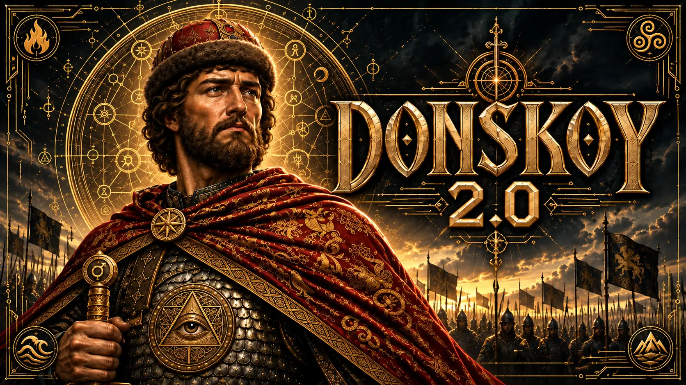

# Donskoy_2.0



**RU · EN · UA**  
**© 2026 Дмитрий Иванович Филатов / Dimitri Ivanovich Filatov / Дмитро Іванович Філатов** · псевдоним / pseudonym / псевдонім

## RU — Русский

**«Донской 2.0» — интерактивный роман в двенадцати главах.**

Антрополог Аркадий Левшин соглашается подтвердить подлинность княжеских останков. Его подпись запускает маршрут от Архангельского собора к современной войне. Земля, Небо и вычислительная система образуют три взаимодействующих повествовательных слоя, а читатель становится участником протокола.

**[Читать полный роман](https://donskoy2-0.pages.dev/)** · [Открыть демо](https://donskoy2-0.github.io/Donskoy2-0/) · [Лицензия Right to Read 2.0 — RU](license/ru.html)

Это публичный репозиторий демонстрационного просмотрщика и открытых клиентских компонентов, **а не публикация полного защищённого литературного корпуса**. Для полного чтения используйте официальный сайт.

## EN — English

**Donskoy_2.0 is a twelve-chapter interactive novel.**

Anthropologist Arkady Levshin agrees to authenticate a prince's remains. His signature sets in motion a journey from the Archangel Cathedral toward a modern war. Earth, Heaven and a computational system form three interacting narrative layers, while the reader becomes a participant in the protocol.

**[Read the complete novel](https://donskoy2-0.pages.dev/)** · [Open the demo](https://donskoy2-0.github.io/Donskoy2-0/) · [Right to Read License 2.0 — EN](license/right-to-read-2.0.html)

This public repository contains the demonstration reader and public client modules, **not the complete protected literary corpus**. The full novel is hosted on the official website.

## UA — Українська

**«Донський 2.0» — інтерактивний роман із дванадцяти розділів.**

Антрополог Аркадій Левшин погоджується підтвердити справжність князівських останків. Його підпис запускає шлях від Архангельського собору до сучасної війни. Земля, Небо й обчислювальна система утворюють три взаємопов’язані оповідні шари, а читач стає учасником протоколу.

**[Читати повний роман](https://donskoy2-0.pages.dev/)** · [Відкрити демо](https://donskoy2-0.github.io/Donskoy2-0/) · [Ліцензія Right to Read 2.0 — UA](license/ua.html)

Цей публічний репозиторій містить демонстраційний переглядач і відкриті клієнтські модулі, **а не повний захищений літературний корпус**. Повний роман доступний на офіційному сайті.

---

## Материалы / Project files / Матеріали

- [Демо / Demo / Демонстрація](demo/index.html) — 12 глав / chapters / розділів, три слоя / layers / шари, RU / EN / UA.
- [Читалка / Reader / Читалка](src/reader/) — оформление / presentation / оформлення, звук / audio / звук, иллюстрации / images / ілюстрації.
- [Ядро / Kernel / Ядро](src/kernel/) и / and / і [граф сцен / scene graph / граф сцен](canon/) — переходы и возврат / navigation and rewind / переходи та повернення.
- [Клиент / Runtime / Клієнт](src/runtime/) и / and / і [оболочка / Shell / Оболонка](src/shell/) — интерфейс и состояние чтения / reader UI and state / інтерфейс і стан читання.
- [Медиа / Media / Медіа](assets/) — шрифты / fonts / шрифти, изображения / images / зображення, аудио / audio / аудіо.
- [Проверки / Checks / Перевірки](tests/) — существующие проверки / existing checks / наявні перевірки.

## Локальный запуск / Run locally / Локальний запуск

Скачайте репозиторий и откройте `demo/index.html` в браузере; можно загрузить собственный JSON или [пример данных](demo/data/edition.json).  
Download the repository and open `demo/index.html` in a browser; load a custom JSON file or the [sample data](demo/data/edition.json).  
Завантажте репозиторій і відкрийте `demo/index.html` у браузері; можна завантажити власний JSON або [приклад даних](demo/data/edition.json).

Node.js 22+:

```sh
npm test
npm run build
```

**[RU · Right to Read 2.0](license/ru.html) · [EN · Right to Read 2.0](license/right-to-read-2.0.html) · [UA · Right to Read 2.0](license/ua.html)**  
© 2026 Дмитрий Иванович Филатов / Dimitri Ivanovich Filatov / Дмитро Іванович Філатов. Все права защищены, кроме прямо предоставленных лицензией / All rights reserved except as expressly licensed / Усі права захищено, крім прямо наданих ліцензією.
